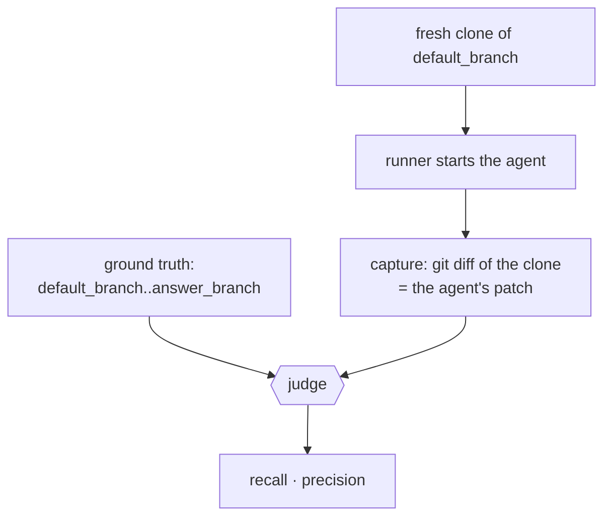

# Building a repo corpus

How to build repo tasks that separate a good agent from a weak one and do not give their
answers away. For question tasks, see [docs/question-tasks.md](docs/question-tasks.md).

[Back to the README](README.md)

## Contents

- [What a task is](#what-a-task-is)
- [How a task is scored](#how-a-task-is-scored)
- [Two ways a task leaks its answer](#two-ways-a-task-leaks-its-answer)
- [A checklist for each task](#a-checklist-for-each-task)
- [Wiring a task into the config](#wiring-a-task-into-the-config)
- [Tasks from other people's repositories](#tasks-from-other-peoples-repositories)

## What a task is

A task is a git repository with two branches.

- **The default branch** holds the broken or unfinished state. The agent starts here.
- **The answer branch** holds the fix. The agent never sees it.
- **The reference solution** is the diff between the two. The judge grades against it.


Branch names vary from repo to repo: `main`, `master`, `buggy`, `solution`, `working`. The
config's `default_branch` and `answer_branch` fields say which is which.

A good task has two properties:

- **It discriminates.** A capable agent solves it and a weak one does not.
- **It does not leak.** Nothing but the answer branch reveals the fix.

## How a task is scored



- **The agent works in a throwaway clone.** It holds the default branch alone and has no
  remote, so the answer cannot be fetched. Your corpus repo is only read.
- **Recall** is how much of the reference solution the agent reproduced.
- **Precision** is how much of the agent's patch was needed, not collateral damage.
- **An agent that changes nothing** is graded on its empty diff and counted in the average.

One clear defect per task keeps both numbers easy to read.

## Two ways a task leaks its answer

A task leaks when the agent or the judge can reach the answer without doing the work.


### Contamination: avoid famous defects

- A capable model recognises Heartbleed, Shellshock or a textbook off-by-one on sight.
- When it does, you are measuring what it remembers, not how it debugs.
- Prefer subtle, real defects whose fix turns on an invariant, a race or a contract.
- Prefer fixes newer than the model's training data.

### Label leakage: do not point at the answer

The judge reads the repo's README. If the README says "this repo has an intentional bug", or
the broken line carries a `# Buggy` comment, both the agent and the judge read the hint
instead of the code. In one real run this turned real contract violations into "intended
design" and quietly corrupted the grades.

- Write the README as a real library would. State what each function is supposed to do, never
  that it is wrong.
- Remove comments that point at the defect. Leave the broken line where it is.
- Keep the fix in exactly one place: the answer branch.

## A checklist for each task

- [ ] The repository root is the task. A folder inside another repository is refused.
- [ ] The default branch is a branch or tag, and it holds the broken state.
- [ ] The answer branch differs from the default branch.
- [ ] Every file the answer branch changes is part of the fix, or is listed under `ignore`.
- [ ] The README states the contract and does not mention the bug.
- [ ] No comment points at the defect.
- [ ] The defect is not famous.
- [ ] The task has one defect, or one coherent set.

`examples/sample-corpus/build.sh` is a small worked example: two repos, each with a `buggy`
branch, a `fixed` branch, and a README that states the contract.

## Wiring a task into the config

```yaml
corpus:
  - name: my-task                 # unique
    path: repos/my-task           # relative to the config file
    invoke: "Find and fix the bug in this repository."
    default_branch: buggy
    answer_branch: fixed
    holdout: true                 # optional; scored by optimize, never shown to the rewrite
    ignore: ["dist/**"]           # optional; paths that are not part of the fix
```

- Every field is described in [docs/configuration.md](docs/configuration.md#a-repo-task).
- `holdout` is explained in [docs/optimize.md](docs/optimize.md#the-held-out-split).

**Check what your answer branch really changes.** Run `git diff --stat default..answer` on
each task. Answer branches often carry more than the fix:

- a rebuilt bundle or other generated output
- a rewritten README
- a file of solution notes

The judge counts every change in the answer as something the agent should have done. On one
real task this scored an agent that fixed both bugs at 0.40 recall, because three of the five
"items" were files like these. List them under `ignore` and they are left out of both sides.

## Tasks from other people's repositories

- Do not commit large or licensed corpora into your own repo.
- List them by URL and clone them at setup.
- **Pin both branches to exact commits.** If upstream moves its answer branch, an unpinned
  corpus quietly changes what you grade against.

`corpora/manifest.yaml` and `corpora/fetch.sh` show the pattern: each entry has a `pin` for
the default branch and an `answer_pin` for the answer branch.
