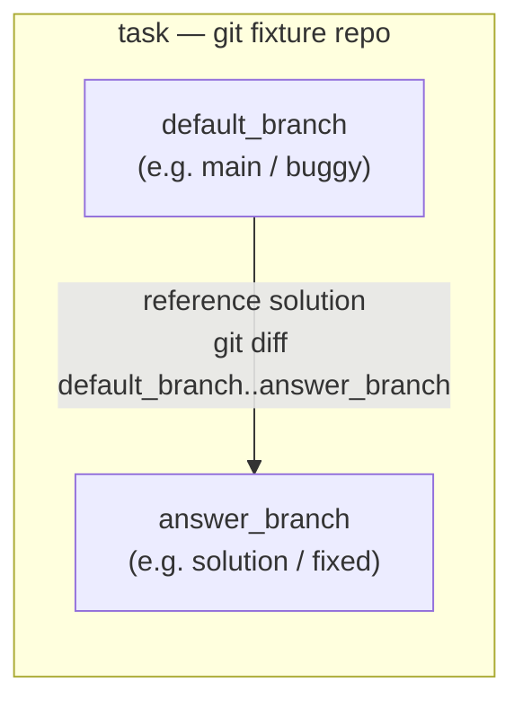
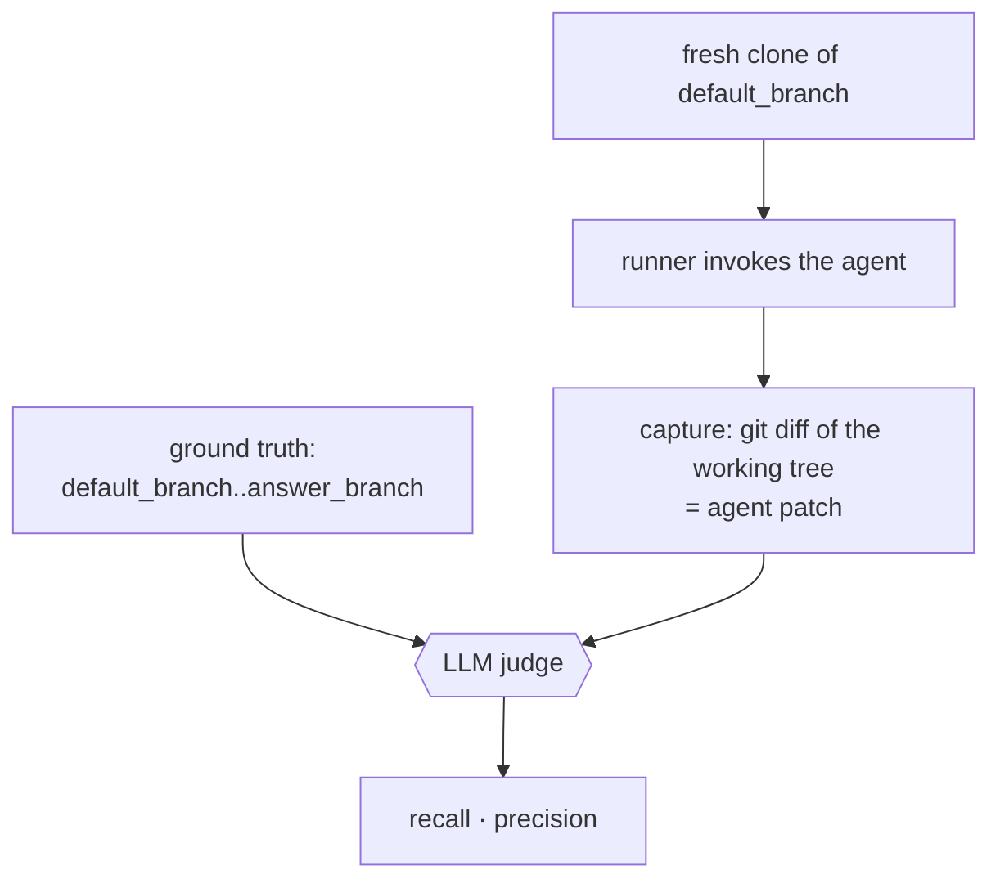
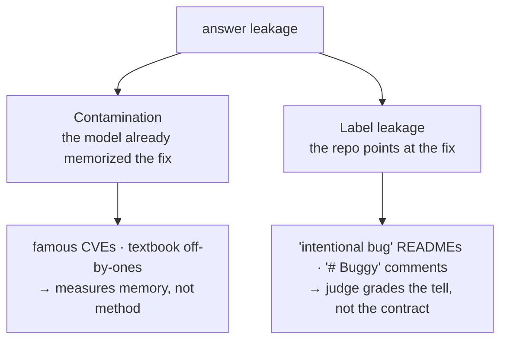

# Authoring a corpus

A **task** is a git fixture repository with two branches: a **default branch** (the broken or
incomplete state the agent starts from) and a **solution branch** (the held-out ground truth). The
literal branch names vary per repo — `main`/`master`, `buggy`, `solution`, `working` all appear in
the existing corpus — so the config's `default_branch` and `answer_branch` fields name them for the
harness (the solution branch is the `answer_branch` field); you point those fields at whatever the repo
actually calls its branches. The
**reference solution** is the diff between the two, and the judge grades the agent's patch against
it. Your eval is only as good as these tasks, so two properties carry the most weight: every task
must be **discriminative** (it separates a capable agent from a weak one) and **leak-free** (nothing
but the solution branch reveals the fix).

## Anatomy of a task



The agent never sees `answer_branch`. It works in a throwaway clone that holds `default_branch`
alone, with no remote to fetch the answer from, is asked to fix the repo, and is graded on how
close its patch comes to the reference solution. Your corpus repo is only read.

## How a task is scored



**Recall** is how much of the reference solution the agent reproduced; **precision** is how much
of the agent's patch was warranted rather than collateral damage. A clean, single-purpose task
keeps both metrics interpretable.

## Designing out answer leakage

A task leaks when the agent or the judge can reach the answer without doing the work. There are
two distinct channels, and a good task closes both.



### Contamination: avoid famous defects

A capable model recognizes Heartbleed, Shellshock, or a textbook off-by-one on sight. When it
does, you are measuring training-set recall, not debugging skill. Prefer subtle, real defects
whose fix turns on an invariant, a race, or a contract, and where the surrounding code offers no
hint. Discriminative tasks are the ones a model must actually reason through, not pattern-match.

### Label leakage: do not telegraph the answer

The judge reads the repo's README. If the README says "this repo has an intentional bug for
practice," or the defective line carries a `# Buggy` comment, both the agent and the judge read
the tell instead of the contract. In one real run this flipped genuine contract violations into
"intended design" and silently corrupted the grades. So:

- Write the README as a real library would: state each function's **contract** (what it is
  supposed to do), never that it is wrong.
- Strip comments that point at the defect. Leave the defective line exactly where it is.
- The fix exists in exactly one place: the `answer_branch`.

## Practical shape

- One defect (or one coherent set) per task keeps recall and precision interpretable.
- Leave `default_branch` checked out as the repo's default, so a fresh clone lands in the broken
  state the agent will see.
- `examples/sample-corpus/build.sh` is a minimal worked example: two repos, each with a `buggy`
  default branch and a `fixed` solution branch, a README stating the contract, and no tells.

## Wiring the harness to your corpus

Each task in the config names the repo path, the agent invocation, and the two branches:

```yaml
corpus:
  - name: my-task
    path: /abs/or/relative/path/to/repo
    invoke: "Find and fix the bug in this repository."
    default_branch: buggy
    answer_branch: fixed
```

## External and licensed corpora

Do not commit large or licensed corpora into your harness repo. Reference them by a pinned git
URL and clone them on setup, so the data stays out of your tree and its provenance stays exact.
