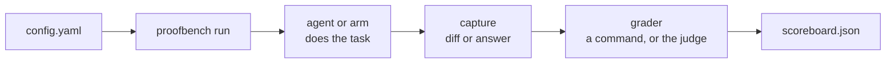

# proofbench

proofbench builds evals for agentic systems, and proves each one can be trusted before you
read a score from it.

- You describe your system and where its known answers come from.
- The `/proofbench` skill writes an eval into your system's own repo.
- The `proofbench` commands take that eval through four gates. Until they pass, it will not
  run.
- Then you run it: every model, every task, graded against the known answer.

It began as the harness behind [crg-debug](examples/crg-debug/README.md), a debugging skill.
It works for any system you can start with one command and whose result can be checked.

## Contents

- [Why it exists](#why-it-exists)
- [Install](#install)
- [Build an eval](#build-an-eval)
- [Try the demos](#try-the-demos)
- [How a run works](#how-a-run-works)
- [A first config](#a-first-config)
- [Two task kinds](#two-task-kinds)
- [Commands](#commands)
- [What a run writes](#what-a-run-writes)
- [Safety](#safety)
- [Eval card](#eval-card)
- [Documentation](#documentation)
- [License](#license)

## Why it exists

Anyone can write a prompt that sounds like a method, and anyone can write an eval that sounds
like a measurement. A score from a broken eval looks exactly like a score from a working one.
Three rules shape the whole tool:

1. **Check the eval before you use it.** A grader is trusted only after it has scored results
   whose right score was already known. An eval is run only after its gates have passed.
2. **Fail loud or do not measure.** A grade that is empty, not a number, or produced by a
   failed step stops the run. A harness that keeps going reports a confident wrong number.
3. **The weak model is the signal.** A loop that learns from misses learns nothing from a
   model that never misses. `optimize` runs against the weakest model on purpose.

[METHODOLOGY.md](METHODOLOGY.md) explains where the last two rules came from.

## Install

The commands:

```bash
uv tool install proofbench      # or: uvx proofbench
```

The skill, inside Claude Code:

```text
/plugin marketplace add CodeBlackwell/proofbench
/plugin install proofbench
```

You also need:

- **The `claude` CLI on your PATH**, for the default runner and for the judge. The judge uses
  its `--tools` and `--safe-mode` flags, so an old version stops the run with the CLI's error.
- **git**, for repo tasks.
- **Python 3.10 or newer.**

The package contains the engine and two prompts for repo tasks. The examples and corpus
scripts live in this repository.

## Build an eval

In the repo of the system you want to evaluate, run `/proofbench`. It works in this order:

1. **It reads your repo** to learn how the system starts and what it leaves behind.
2. **It asks you** what claim the eval should test and what the kinds of right answer are.
3. **It writes the eval** into `evals/<name>/`: a config, an adapter that starts your system,
   the tasks, and a rubric if a judge is needed.
4. **It takes the eval through four gates**, each decided by a command:

| Gate | Passes when |
|---|---|
| `adapter` | Your system starts on one task and a result comes back |
| `coverage` | Every kind of answer you declared has a task |
| `controls` | The grader scores results with a known right score as predicted |
| `headroom` | The strongest model scores some of it, and not all |

- Answers are mined from history you own, or asked of you. An answer a model invented is
  never accepted without your approval.
- It can grade the path as well as the result: the steps your system took, checked by rules
  you declare and by a judge. See [Grading the path](docs/building-an-eval.md#grading-the-path).
- The skill states the cost and waits before every step that spends money.
- You can do all of it by hand. [docs/building-an-eval.md](docs/building-an-eval.md) covers
  each gate and command.

Not sure what the eval should test? Run `/eval-docket` first. It asks you, in multiple
choice, which claims about your system can honestly be tested, and writes the answers to
`evals/docket.md`: where each claim's known answers come from, whether your system is shown
enough to reach them, and what was ruled out. `/proofbench` reads that file and skips what it
already answers. On an eval that has tasks, `/eval-docket` also finds the ones with more than
one defensible answer and puts each to you for a ruling.

## Try the demos

The demos are stubs with no gates, so they run with `--unchecked`.

The offline demo needs no API key and no `claude` CLI:

```bash
git clone https://github.com/CodeBlackwell/proofbench && cd proofbench
uv run proofbench run --unchecked --config examples/question-demo/proofbench.question.yaml
```

The repo demo runs a real agent on two toy repositories and costs a few cents:

```bash
bash examples/sample-corpus/build.sh        # builds two toy repos, each with a bug and a fix
uv run proofbench run --demo --unchecked    # runs the agent, then grades it against the fix
```

## How a run works



1. **Read the config.** It is checked whole before anything is paid for.
2. **Run the agent** on each task, once per model in `models`.
3. **Capture** what the agent produced: a git diff for a repo task, an answer for a question.
4. **Grade** it: by running a command where one can check the result, and otherwise by a
   judge model that compares it to the known answer.
5. **Write the scoreboard**, one entry per model.

`optimize` adds a loop on top: baseline, rewrite the skill, re-run, then keep or revert.
See [docs/optimize.md](docs/optimize.md).

## A first config

```yaml
runner: claude                 # the built-in runner; any executable also works
models: [opus, sonnet, haiku]  # strongest first
judge_model: opus              # the same judge for every model
judge: default                 # the judge prompt proofbench ships for repo tasks
corpus:
  - name: primes
    path: examples/sample-corpus/repos/primes
    invoke: "Find and fix the bug in this repository."
    default_branch: buggy      # the broken state the agent starts from
    answer_branch: fixed       # the known answer
```

- Paths are relative to the config file.
- Every key, its default and the checks made at load are in
  [docs/configuration.md](docs/configuration.md).

## Two task kinds

One corpus holds one kind.

| | `repo` (the default) | `question` |
|---|---|---|
| The task | Fix a repository | Answer a question |
| The known answer | A branch holding the fix | An answer key in a JSONL file |
| What runs | `claude`, or your executable, inside a throwaway clone | Your executable, called an arm |
| What is graded | The diff the agent leaves | The answer the arm prints |
| Who grades | A `check` command, or the judge model | An exact id match first, then the judge for prose, if you give it one |
| Main numbers | `macro_passed`, or `macro_recall` and `macro_precision` | `accuracy`, `pass^k`, `tokens_per_correct` |
| Read more | [CORPUS.md](CORPUS.md) | [docs/question-tasks.md](docs/question-tasks.md) |

## Commands

| Command | What it does |
|---|---|
| `proofbench run --config FILE` | Run every model over the corpus and write a scoreboard |
| `proofbench optimize --config FILE` | Rewrite the `subject` from its misses; keep the rewrite only if the score improves |
| `proofbench status --config FILE` | Print each gate of the eval: passed, failed, stale or not run |
| `proofbench controls --config FILE` | Write the mechanical controls and their predictions |
| `proofbench check GATE --config FILE` | Run one gate and record the result |
| `proofbench run --demo --unchecked` | Run the repo demo (needs a clone of this repository) |
| `proofbench --version` | Print the version |

- `--run-id NAME` names the run folder. Without it the folder is named for the start time.
- `run` and `optimize` refuse an eval whose gates have not passed. `--unchecked` runs it
  anyway and marks the scoreboard. See [docs/building-an-eval.md](docs/building-an-eval.md).
- The exit code is 1 on any hard stop, and the reason is printed in one line.

## What a run writes

Everything goes under `runs/<run-id>/`, in the directory you ran the command from:

- `scoreboard.json`: the numbers, one entry per model.
- One folder per model and task, holding the agent's log, what it produced, and its grade.

A folder that already holds a run is refused, so two runs never mix. The full layout and the
shape of each file are in [docs/io-contracts.md](docs/io-contracts.md).

## Safety

- **The agent runs with permissions skipped.** A repo task starts `claude` with
  `--dangerously-skip-permissions`. It works in a throwaway clone, but the clone is not a
  sandbox: the agent can still reach the rest of your machine. Run untrusted corpora in a
  container or VM.
- **Your corpus repos are only read.** proofbench never resets, cleans or commits in them.
- **The agent cannot reach the answer through git.** The clone holds the broken branch alone
  and has no remote.
- **The judge has no tools.** It reads text the agent wrote, so it runs with no tools and none
  of your `CLAUDE.md`, hooks, plugins or MCP servers.
- **`optimize` edits your subject file.** The original is put back unless the rewrite is kept,
  including when the run crashes or is interrupted.

## Eval card

What has been measured about proofbench itself, and what has not. Measured on 2026-11-21, on
the code released as 0.8.0. Costs are API prices; the runs were paid through a Claude
subscription.

**The claim under test:** an eval that has passed proofbench's gates can be trusted, and the
`/proofbench` skill builds one without breaking its own rules.

**What was measured**

| What | How | Result |
|---|---|---|
| The code | Unit tests on Python 3.10 to 3.13, in CI | 321 pass |
| Graders, against results with a known right score | Controls predicted before grading, on three evals of two real systems | 362 of 362 graded as predicted |
| The path judge | 34 of those controls: recorded paths, ruined paths, hand-written cases | 34 of 34, on two separate runs |
| The builder, on Opus | `/proofbench` run unaided on three real targets, its eval folder checked by a held-back script | 3 of 3 right, after one ruling by the owner |
| The builder's hard rules | Three rule scripts over each Opus session's step log: never write `gates.json`, never use `--unchecked`, never start a paid gate unapproved | Held in 3 of 3 sessions |
| The builder, on Sonnet | One target. Its folder was written but not graded | Stopped for a yes before its first paid step |

- **The two systems:** tenex, a security console agent, and Triage Desk, an agent that
  classifies failed CI tests.
- **The ruling:** on one target the builder wrote nothing and put three gaps to the owner
  first. The check wanted a folder. The owner ruled that asking was right.
- **What the gates refused on real evals:** an answer key a model wrote, which the strongest
  model scored 100% on; a set where only one class had real cases; and an eval whose answers
  the system could not reach, on which the strongest model scored 0 of 21.

**What it cost**

| Step | Cost |
|---|---|
| All four gates on tenex's eval: 42 questions, 218 controls, a judge and a path judge | $7.98 |
| All four gates on a 25-question eval graded by exact match | $4.45 |
| The builder's own eval: three Opus sessions and one Sonnet session | $3.73 |

**What has not been measured**

- **Judges against a person.** A judge is held to predictions on controls. No judge verdict
  on a real attempt has been compared with human labels.
- **The gates as a detector.** They have not been scored on a set of deliberately broken
  evals. The cases above are the ones met by accident, and the 0 of 21 passed the headroom
  gate until a floor was added because of it.
- **Noise.** The same model scored 31 of 42 and then 27 of 42 on tenex with nothing changed.
  proofbench reports no interval.
- **A builder worse than Opus.** Opus passes all three targets, so the builder's eval fails
  proofbench's own headroom rule and cannot yet tell a good builder from a better one. Its
  controls gate has not passed.
- **`/eval-docket`.** One short trial of its first pass. Its second pass has never been run.

**Known limits**

- **A system that rightly declines to act cannot be graded on a repo task.** Only its diff
  and its step log are graded, and declining leaves neither.
- **A script rule can raise false alarms.** tenex's grounding rule flagged 3 of 42 answers,
  and all 3 were sound: two wrote a number with a thousands separator.
- **This card is the author's report.** tenex's eval sits on an unpushed branch and Triage
  Desk is private, so most of these numbers cannot be reproduced from this repository. The
  free checks can: `uv run pytest`, and the demos under [Try the demos](#try-the-demos).
- **proofbench checked proofbench.** The builder's eval was gated by the code under test.

The record behind each line is in [docs/builder-plan.md](docs/builder-plan.md).

## Documentation

| Page | Read it when you want to |
|---|---|
| [docs/building-an-eval.md](docs/building-an-eval.md) | Take an eval through its gates, write controls, grade by command, or grade the path |
| [docs/configuration.md](docs/configuration.md) | Look up a config key, a default, or a load-time error |
| [docs/io-contracts.md](docs/io-contracts.md) | Write a runner, an arm or a step log, or read the files a run writes |
| [docs/question-tasks.md](docs/question-tasks.md) | Build a question corpus and understand its numbers |
| [docs/optimize.md](docs/optimize.md) | Use the self-improving loop and its held-out split |
| [CORPUS.md](CORPUS.md) | Build repo tasks that are hard to game and do not leak their answer |
| [METHODOLOGY.md](METHODOLOGY.md) | Understand why the tool is built the way it is |
| [examples/crg-debug/README.md](examples/crg-debug/README.md) | See a real config for a real skill |
| [docs/crg-eval-journey.md](docs/crg-eval-journey.md) | Read the story of the evaluation that produced the tool |
| [docs/crg-eval-results.md](docs/crg-eval-results.md) | See that evaluation's tables and per-round verdicts |

## License

MIT.
