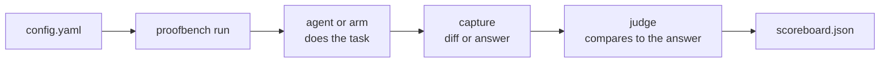

# proofbench

proofbench measures whether an agent skill actually works, and can improve the skill without
letting it grade itself.

- You give it tasks you already know the answers to.
- It runs an agent over them and grades the result against the known answer.
- With `optimize`, it rewrites the skill from its misses and keeps the rewrite only if the
  score holds.

It began as the harness behind [crg-debug](examples/crg-debug/README.md), a debugging skill.
It works for any skill whose output can be compared to a known answer.

## Contents

- [Why it exists](#why-it-exists)
- [Install](#install)
- [Quickstart](#quickstart)
- [How it works](#how-it-works)
- [A first config](#a-first-config)
- [Two task kinds](#two-task-kinds)
- [Commands](#commands)
- [What a run writes](#what-a-run-writes)
- [Safety](#safety)
- [Documentation](#documentation)
- [License](#license)

## Why it exists

Anyone can write a prompt that sounds like a method. The honest test is to measure it against
known answers, on a model weak enough to fail. Two rules shape the whole tool:

1. **Fail loud or do not measure.** A grade that is empty, not a number, or produced by a
   failed step stops the run. A harness that keeps going reports a confident wrong number.
2. **The weak model is the signal.** A loop that learns from misses learns nothing from a
   model that never misses. `optimize` runs against the weakest model on purpose.

[METHODOLOGY.md](METHODOLOGY.md) explains where both rules came from.

## Install

```bash
uv tool install proofbench      # or: uvx proofbench
```

You also need:

- **The `claude` CLI on your PATH**, for the default runner and for the judge. The judge uses
  its `--tools` and `--safe-mode` flags, so an old version stops the run with the CLI's error.
- **git**, for repo tasks.
- **Python 3.10 or newer.**

The install contains the engine and two prompts for repo tasks. The examples and corpus
scripts live in this repository.

## Quickstart

The offline demo needs no API key and no `claude` CLI:

```bash
git clone https://github.com/CodeBlackwell/proofbench && cd proofbench
uv run proofbench run --config examples/question-demo/proofbench.question.yaml
```

The repo demo runs a real agent on two toy repositories and costs a few cents:

```bash
bash examples/sample-corpus/build.sh        # builds two toy repos, each with a bug and a fix
uv run proofbench run --demo                # runs the agent, then grades it against the fix
```

## How it works



1. **Read the config.** It is checked whole before anything is paid for.
2. **Run the agent** on each task, once per model in `models`.
3. **Capture** what the agent produced: a git diff for a repo task, an answer for a question.
4. **Grade** it against the known answer.
5. **Write the scoreboard**, one entry per model.

`optimize` adds a loop on top: baseline, rewrite the skill, re-run, then keep or revert.
See [docs/optimize.md](docs/optimize.md).

## A first config

```yaml
runner: claude                 # the built-in runner; any executable also works
models: [opus, sonnet, haiku]  # strongest first
judge_model: opus              # the same judge for every model
judge: default                 # the judge prompt proofbench ships for repo tasks
corpus:
  - name: primes
    path: examples/sample-corpus/repos/primes
    invoke: "Find and fix the bug in this repository."
    default_branch: buggy      # the broken state the agent starts from
    answer_branch: fixed       # the known answer
```

- Paths are relative to the config file.
- Every key, its default and the checks made at load are in
  [docs/configuration.md](docs/configuration.md).

## Two task kinds

One corpus holds one kind.

| | `repo` (the default) | `question` |
|---|---|---|
| The task | Fix a repository | Answer a question |
| The known answer | A branch holding the fix | An answer key in a JSONL file |
| What runs | `claude`, or your executable, inside a throwaway clone | Your executable, called an arm |
| What is graded | The diff the agent leaves | The answer the arm prints |
| Who grades | The judge model | An exact id match first, the judge only for prose |
| Main numbers | `macro_recall`, `macro_precision` | `accuracy`, `pass^k`, `tokens_per_correct` |
| Read more | [CORPUS.md](CORPUS.md) | [docs/question-tasks.md](docs/question-tasks.md) |

## Commands

| Command | What it does |
|---|---|
| `proofbench run --config FILE` | Run every model over the corpus and write a scoreboard |
| `proofbench optimize --config FILE` | Rewrite the `subject` from its misses; keep the rewrite only if the score holds |
| `proofbench run --demo` | Run the repo demo (needs a clone of this repository) |
| `proofbench --version` | Print the version |

- `--run-id NAME` names the run folder. Without it the folder is named for the start time.
- The exit code is 1 on any hard stop, and the reason is printed in one line.

## What a run writes

Everything goes under `runs/<run-id>/`, in the directory you ran the command from:

- `scoreboard.json`: the numbers, one entry per model.
- One folder per model and task, holding the agent's log, what it produced, and its grade.

A folder that already holds a run is refused, so two runs never mix. The full layout and the
shape of each file are in [docs/io-contracts.md](docs/io-contracts.md).

## Safety

- **The agent runs with permissions skipped.** A repo task starts `claude` with
  `--dangerously-skip-permissions`. It works in a throwaway clone, but the clone is not a
  sandbox: the agent can still reach the rest of your machine. Run untrusted corpora in a
  container or VM.
- **Your corpus repos are only read.** proofbench never resets, cleans or commits in them.
- **The agent cannot reach the answer through git.** The clone holds the broken branch alone
  and has no remote.
- **The judge has no tools.** It reads text the agent wrote, so it runs with no tools and none
  of your `CLAUDE.md`, hooks, plugins or MCP servers.
- **`optimize` edits your subject file.** The original is put back unless the rewrite is kept,
  including when the run crashes or is interrupted.

## Documentation

| Page | Read it when you want to |
|---|---|
| [docs/configuration.md](docs/configuration.md) | Look up a config key, a default, or a load-time error |
| [docs/io-contracts.md](docs/io-contracts.md) | Write a runner or an arm, or read the files a run writes |
| [docs/question-tasks.md](docs/question-tasks.md) | Build a question corpus and understand its numbers |
| [docs/optimize.md](docs/optimize.md) | Use the self-improving loop and its held-out split |
| [CORPUS.md](CORPUS.md) | Build repo tasks that are hard to game and do not leak their answer |
| [METHODOLOGY.md](METHODOLOGY.md) | Understand why the tool is built the way it is |
| [examples/crg-debug/README.md](examples/crg-debug/README.md) | See a real config for a real skill |
| [docs/crg-eval-journey.md](docs/crg-eval-journey.md) | Read the story of the evaluation that produced the tool |
| [docs/crg-eval-results.md](docs/crg-eval-results.md) | See that evaluation's tables and per-round verdicts |

## License

MIT.
