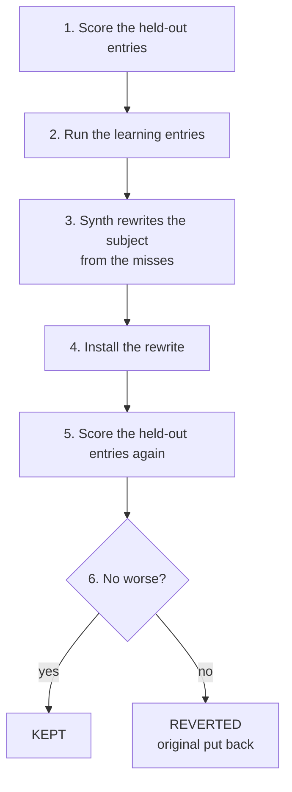

# The optimize loop

`optimize` rewrites a skill from its own misses and keeps the rewrite only if the score holds.
The model proposes. A comparison of two numbers decides.

[Back to the README](../README.md)

## Contents

- [What you need](#what-you-need)
- [What happens](#what-happens)
- [The held-out split](#the-held-out-split)
- [The gate](#the-gate)
- [What the rewrite is shown](#what-the-rewrite-is-shown)
- [What gets written](#what-gets-written)
- [Your subject file is safe](#your-subject-file-is-safe)
- [Limits to know](#limits-to-know)

## What you need

`optimize` refuses to start, before spending anything, unless the config has all four:

| Need | Config | Meaning |
|---|---|---|
| Something to rewrite | `subject` | Path to the skill or prompt file |
| A rewrite prompt | `synth` | A path, or `default` on a repo corpus |
| A number to compare | `objective` | See [the objective](configuration.md#the-objective) |
| Two sets of tasks | `holdout: true` on some corpus entries | See [the held-out split](#the-held-out-split) |

Your agent or arm must actually read the subject file, or the rewrite changes nothing.

```yaml
subject: skills/triage.md
synth: synth.md
objective: pass^3
models: [opus, haiku]          # optimize runs against the last one
corpus:
  - { kind: question, file: questions/train.jsonl }
  - { kind: question, file: questions/heldout.jsonl, holdout: true }
```

## What happens



1. **Score the held-out entries** with the current subject. This is the baseline.
2. **Run the learning entries** to collect misses.
3. **The synth rewrites the subject** from those misses.
4. **The rewrite is installed** in place of the subject.
5. **The held-out entries are scored again.**
6. **The two scores are compared.** No worse means kept. Worse means reverted.

Everything runs against the **last** entry of `models`, the weakest. Only misses teach, and a
strong model on easy tasks misses nothing.

## The held-out split

Mark the entries the gate scores on with `holdout: true`. The unmarked entries are the ones
the rewrite learns from.

```yaml
corpus:
  - { name: learn-1, path: repos/a, invoke: "/my-skill", default_branch: buggy, answer_branch: fixed }
  - { name: check-1, path: repos/c, invoke: "/my-skill", default_branch: buggy, answer_branch: fixed, holdout: true }
```

Why it is required:

- The synth is shown the expected answers to what the subject missed.
- If the rewrite were scored on those same entries, it could pass by memorising them.
- Scoring on entries it never saw measures whether the rewrite generalises.

Rules:

- Both sides must hold at least one entry.
- On a question corpus, no question id may appear on both sides.
- `run` ignores `holdout` and benches every entry.

Choose held-out entries that look like the learning ones. A held-out set of a different kind
of task tells you little.

## The gate

The comparison runs in the direction that is better for the objective.

| Objective | Kept when |
|---|---|
| A rate, a recall, `pass^k`, `pass@k` | The new score is the same or higher |
| `tokens_per_correct`, `tokens_per_correct_abstention` | The new score is the same or lower |

- The verdict comes from the comparison alone. Nothing the model says can change it.
- An objective that is undefined on a leg stops the run. A leg with nothing correct has no
  token price, for example.

## What the rewrite is shown

| Corpus | The synth sees |
|---|---|
| repo | The full grade of every learning task: the judge's items, misses and notes |
| question | Only the learning questions missed on at least one trial: the question, the expected answer, and what each trial answered |

- It never sees a held-out entry.
- On a question corpus it never sees fields outside the question format, such as your notes
  on evidence.
- A question baseline with no misses stops the run. There is nothing to learn from.

## What gets written

Inside `runs/<run-id>/`:

| File | Holds |
|---|---|
| `baseline-holdout/` | The held-out entries scored before the rewrite |
| `baseline/` | The learning entries |
| `improved/` | The held-out entries scored after the rewrite |
| `subject.bak` | The subject as it was |
| `subject.candidate` | The rewrite |
| `changelog.md` | What the synth says it changed, and why |
| `result.json` | The objective, both scores, the verdict, and the held-out entries used |

## Your subject file is safe

- The rewrite replaces the subject only while it is being scored.
- The original is put back unless the rewrite is kept.
- That holds when the run crashes, is interrupted with Ctrl-C, or stops on an undefined
  objective.
- `subject.bak` and `subject.candidate` stay in the run folder either way.

## Limits to know

- **A tie is kept.** A rewrite that changes nothing on the held-out entries passes the gate.
- **One run is one sample.** Agents are not deterministic. A small held-out set can move by
  chance, so use enough entries, or `trials` on a question corpus, to trust a verdict.
- **One rewrite per run.** `optimize` does not loop. Run it again to try another step.
